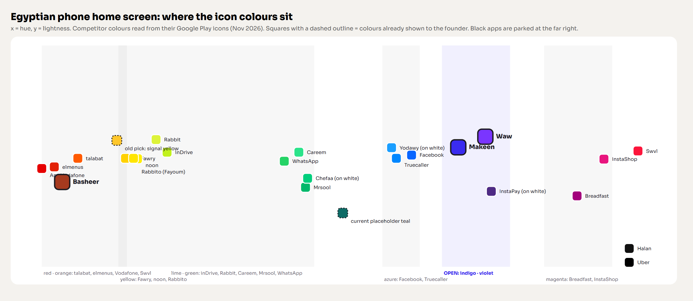
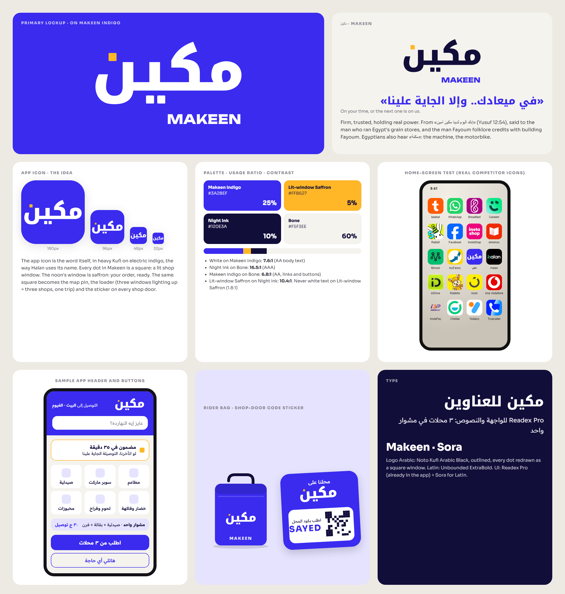
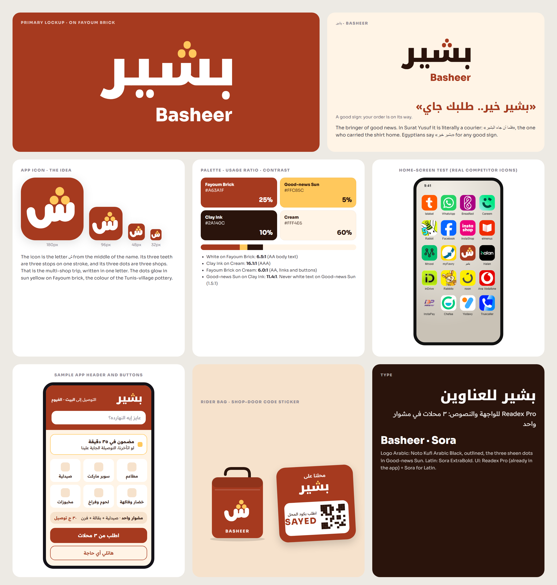
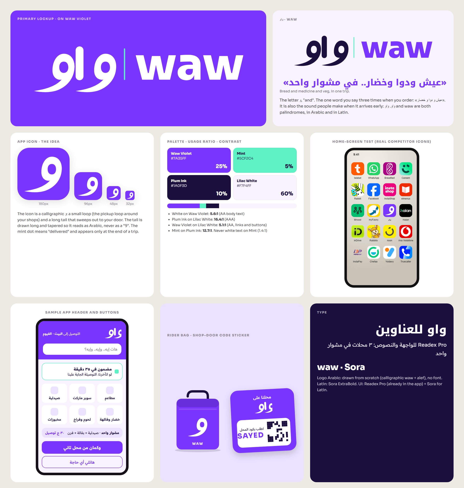

# Brand round 1: naming and visual identity

Reviewer: brand identity director (naming and visual identity).
Folder: `brand/round1/`. Boards: [makeen-board.png](makeen-board.png), [basheer-board.png](basheer-board.png), [waw-board.png](waw-board.png). Colour map: [colormap.png](colormap.png). Every logo and icon is a pure-path SVG, regenerated from `src/` with `node src/final.js`.

---

## 1. Executive recommendation

1. **Name it «مكين» · Makeen.** It means firm, trusted and powerful. It comes from «إنك اليوم لدينا مكين أمين» (Yusuf 12:54), said to the man who ran Egypt's grain stores, and Fayoum folklore credits that same Yusuf with building Fayoum and Bahr Youssef.
2. It is the Careem pattern (ka-REEM → ma-KEEN): two syllables, one clean Latin spelling, a real Arabic word that sounds like a global company. Egyptians also hear «مكنة», the machine and the motorbike.
3. It answers the founder's literal ask ("a name that says this app is powerful"), and it works in every sentence: «اطلب من مكين»، «مكين جاي»، «هطلبها على مكين».
4. Google Play Egypt and web checks found **no delivery or commerce app called Makeen**. Only a Quran app, a home-foundation app and a teachers' platform use the word. The other two finalists (Basheer and Waw) are backups. Seven of my strongest ideas died on real conflicts: Makook and Nahla are already Egyptian delivery apps, Haat is an Israel/Palestine/Morocco delivery app, and Madmoon, Barq, Nayzak and Hodhod are taken by delivery or courier apps.
5. Colour: **electric indigo #3A2BEF with one saffron "lit window"**. This is the only open lane on an Egyptian home screen. The old "black + signal yellow" pick lands on top of Fawry, noon and **Rabbito, the delivery app that already operates in Fayoum and is yellow**.

Tagline: **«في ميعادك.. وإلا الجاية علينا»** (on your time, or the next one is on us). The guarantee pillar is the slogan.

---

## 2. Territories and the full candidate list

Six territories. The rules were: a real Arabic word or a natural coinage, 2 syllables (3 at most), at most 7 Latin letters, one obvious spelling, and it must fit groceries, pharmacy and food alike. Each name was screened for Egyptian slang, classical meaning, the three sentence tests and conflicts.

| Territory | Idea |
|---|---|
| T1 Command | "You say it, it comes" (Getir means "bring!", Otlob means "order!") |
| T2 Speed and the moment | The Halan/Fawry lane |
| T3 Abundance and "and… and…" | Everything, in one go |
| T4 The trip and the route | The multi-shop trip (المشوار) |
| T5 Nearness and the neighbourhood | Local shops, the حتة |
| T6 Trust, strength and the courier | The guarantee, the bringer |

| # | Name | Latin | Meaning | T | Verdict |
|---|---|---|---|---|---|
| 1 | هات | Haat | "bring!" (MSA and Egyptian) | T1 | Killed. HAAT Delivery is a live food-delivery app in Israel, Palestine and Morocco (on Play Egypt). Latin "hat" |
| 2 | أمرك | Amrak | "at your command" | T1 | Killed. Same servile family as حاضر (rejected); reads as the name عمرو |
| 3 | أيوه | Aywa | "yes" | T1 | Killed. Pure slang, like دلوقتي |
| 4 | جيب | Geeb | "bring" / pocket | T1 | Killed. Latin "jeep"; MSA meaning is "pocket" |
| 5 | اطلب | Otlob | "order!" | T1 | Killed. Otlob existed and became Talabat |
| 6 | شبيك لبيك | Shobbeek Lobbeek | the genie's "at your wish" | T1 | Killed. Two words; «لبيك» is a Hajj chant |
| 7 | مارد | Marid | genie, giant | T1 | Killed. Quranic «شيطان مارد», a rebellious devil |
| 8 | باشا | Basha | pasha | T1 | Killed. Turkish title, class tone, hundreds of restaurants |
| 9 | ريّس | Rayes | boss, captain | T1 | Killed. «الريس» means the president |
| 10 | شاور | Shawer | "just point" | T1 | Killed. Latin reads "shower" |
| 11 | قول | Qool | "say" | T1 | Killed. ق said three ways (q / ' / g); KOOL cigarettes |
| 12 | دفّة | Daffa | helm | T1 | Killed. Weak link to delivery; "daffy" |
| 13 | **لحظة** | Lahza | moment (founder's) | T2 | Killed. See §4 |
| 14 | برق | Barq | lightning | T2 | Top 15, then killed. BARQ is a Riyadh delivery company ($4M seed); Al Bareq is a delivery app |
| 15 | ومضة | Wamda | flash | T2 | Killed. Wamda is the MENA startup media brand |
| 16 | وميض | Wameed | glint | T2 | Killed. WAMEED driver and tow-truck apps |
| 17 | رمشة | Ramsha | blink | T2 | Killed. Soft; a girl's name |
| 18 | طرفة | Tarfa | blink / anecdote | T2 | Killed. Also means "joke" |
| 19 | طلقة | Talqa | "زي الطلقة", like a bullet | T2 | Killed. Gunfire |
| 20 | خطفة | Khatfa | a quick dash | T2 | Killed. Root means kidnapping |
| 21 | سريع | Saree3 | fast | T2 | Killed. Alsaree3 (Iraq) and ALSAREE delivery; ع |
| 22 | فورًا | Fawran | instantly | T2 | Killed. A Fawry clone |
| 23 | لحظي | Lahzy | real-time | T2 | Killed. Latin reads "lazy" |
| 24 | نيزك | Nayzak | meteor | T2 | Top 15, then killed. Nayzak courier (Palestine) and «شركة النيزك للتوصيل» (KSA) |
| 25 | أوان | Awan | due time | T2 | Killed. Its everyday use is «فات الأوان» (too late) |
| 26 | سهم | Sahm | arrow | T2 | Killed. Sahm is a Saudi brokerage app |
| 27 | تكّة | Takka | click, tick | T2 | Killed. Egyptian «تكّة» is a pyjama drawstring |
| 28 | **واو** | Waw | the letter و ("and") + "wow" | T3 | **Finalist #3** |
| 29 | كمان | Kaman | "and also" | T3 | Top 15. A function word breaks every sentence («نزّلت كمان» = "I also downloaded") |
| 30 | زاد | Zad | provisions | T3 | Top 15, then killed. «زاد» = "prices went up"; many زاد apps; Zad Holding (Qatar food) |
| 31 | خير | Kheir | bounty | T3 | Killed. Kheir Zaman supermarkets |
| 32 | بركة | Baraka | blessing | T3 | Killed. Overused, religious |
| 33 | رخا | Rakha | plenty, cheap times | T3 | Killed. Sounds like رخو (limp) |
| 34 | كُلّه | Kollo | all of it | T3 | Killed. Slang, not ownable |
| 35 | كُلّي | Kolly | "all" / "eat!" | T3 | Killed. «كُلى» = kidneys (bad next to pharmacy) |
| 36 | مونة | Mouna | pantry stock | T3 | Killed. Egyptian «مونة» is also cement mortar |
| 37 | فيض | Fayd | overflow | T3 | Killed. «فاض بيا» = I'm fed up |
| 38 | سلة | Salla | basket | T3 | Killed. Salla is a big Saudi e-commerce platform |
| 39 | قفة | Koffa | basket | T3 | Killed. ق read three ways |
| 40 | شنطة | Shanta | bag | T3 | Killed. «شنطة رمضان» is the vote-buying food bag |
| 41 | ألف | Alf | a thousand / alif | T3 | Killed. One soft syllable; «بألف» = costs 1,000 EGP |
| 42 | هنا | Hana | "here" / bliss | T3 | Killed. Hana Delivery and Hana Driver apps; Hana Bank |
| 43 | شامل | Shamel | all-inclusive | T3 | Killed. Shamel Store (home-needs ordering app) |
| 44 | إمداد | Imdad | supply | T3 | Killed. Imdad is an Egyptian pharmacy-to-warehouse app |
| 45 | رزق | Rizq | livelihood | T3 | Killed. "Rizq: Grocery & Food" delivery app |
| 46 | مكوك | Makook | shuttle («زي المكوك») | T4 | Top 15, then killed. **«مكوك-Makook» is a live delivery app in Tanta**, "كل طلبات بيتك في مكان واحد" |
| 47 | جولة | Gawla | a round | T4 | Top 15. Gawla is an Egypt tourism app; «جولة الإعادة» is an election runoff |
| 48 | مدار | Madar | orbit ("على مدار الساعة") | T4 | Top 15, then killed. Five or more Madar apps, one a fleet app |
| 49 | فلك | Falak | orbit, ark | T4 | Killed. Falak Startups is an Egyptian VC that backs delivery tech |
| 50 | دورة | Dawra | a round | T4 | Killed. Egyptian «الدورة» = period / toilet |
| 51 | لفّة | Laffa | a spin / a wrap | T4 | Killed. A wrap sandwich reads food-only |
| 52 | طلعة | Tal3a | an outing | T4 | Killed. «طلعة جوية» = air sortie |
| 53 | رافد | Rafed | tributary | T4 | Killed. Heard as رافض, "refuses" |
| 54 | مجرى | Magra | channel | T4 | Killed. «مجاري» = sewage |
| 55 | مرسى | Marsa | harbour | T4 | Killed. Heard as مرسي (Morsi) |
| 56 | ساقية | Sa'ya | Fayoum's waterwheel | T4 | Killed. El Sawy Culturewheel; ق; poetic "wine-server" |
| 57 | جاري | Gari | "in progress" / my neighbour | T4 | Killed. Latin "Gary" |
| 58 | دغري | Doghri | straight, honest | T4 | Killed. Doghri cleaning app; Latin "dog" |
| 59 | رحّال | Rahhal | traveller | T4 | Killed. Rahal Taxi |
| 60 | حارة | Hara | alley | T5 | Killed. «حارة سد»; class tone |
| 61 | جارك | Garak | your neighbour | T5 | Killed. Latin "garage" |
| 62 | جنبك | Ganbak | next to you | T5 | Killed. Slang |
| 63 | حتة | Hetta | the area | T5 | Killed. Slang for a girl |
| 64 | عتبة | Ataba | doorstep | T5 | Killed. «عتبة نحس» = a jinxed threshold |
| 65 | دكان | Dokkan | the shop | T5 | Killed. Generic; Dukaan (India) |
| 66 | محلّي | Mahally | local / my shop | T5 | Killed. Mahally is a Saudi app with 62K stores |
| 67 | لمّة | Lamma | a gathering | T5 | Killed for me; it is the copywriter's pick, see §6 |
| 68 | حي | Hayy | district | T5 | Killed. «الحي» = the municipal office |
| 69 | بلدي | Baladi | local | T5 | Killed. Also "lowbrow"; thousands of businesses |
| 70 | وكالة | Wekala | old trade hall | T5 | Killed. Three syllables, ambiguous vowels |
| 71 | **مكين** | Makeen | firm, trusted, powerful | T6 | **Finalist #1** |
| 72 | **بشير** | Basheer | bringer of good news | T6 | **Finalist #2** |
| 73 | متين | Mateen | sturdy, solid | T6 | Top 15, alternate. Fitness app «متين»; «متينة» = plump |
| 74 | مضمون | Madmoon | guaranteed | T6 | Top 15, then killed. «مضمون» delivery app (1K+); «مضمون السودان» (100K+) |
| 75 | أكيد | Akeed | sure | T6 | Killed. Akeed is an Omani food-delivery app |
| 76 | تمام | Tamam | OK | T6 | Killed. Tamam is a Saudi fintech |
| 77 | وعد | Waad | promise | T6 | Killed. Latin "Waad" is read «واد» (boy) |
| 78 | ميعاد | Miaad | appointment | T6 | Killed. ع spelling |
| 79 | أمين | Ameen | trustworthy | T6 | Killed. Reads "Amen" |
| 80 | سديد | Sadeed | on target | T6 | Killed. SADEED and «منصة سديد» apps; SADAD |
| 81 | ميزان | Mizan | scale | T6 | Killed. Mezan app; Meezan Bank |
| 82 | كفيل | Kafeel | guarantor | T6 | Killed. The kafala sponsor system |
| 83 | مظبوط | Mazboot | just right | T6 | Killed. «مضبوط» = seized by police |
| 84 | حامل | Hamel | carrier | T6 | Killed. = pregnant |
| 85 | سفير | Safeer | envoy | T6 | Killed. Safeer Market, Safir delivery |
| 86 | هدهد | Hodhod | hoopoe, Solomon's messenger | T6 | Top 15, then killed. Hudhud Delivery, Elhodhod, Hodhod marketplace |
| 87 | نحلة | Nahla | bee (many flowers, one trip) | T6 | Top 15, then killed. **Bee Drive «النحلة» (Nahla Egypt) motorbike delivery** |
| 88 | حمام | Hamam | pigeons | T6 | Killed. Also "bathroom" |
| 89 | مرسال | Mersal | messenger | T6 | Killed. Mrsool |
| 90 | جدع | Gada3 | stand-up guy | T6 | Killed. Slang; ع |
| 91 | شاطر | Shater | clever | T6 | Killed. Khairat El-Shater |
| 92 | كيان | Kayan | entity | T6 | Killed. «الكيان» = Israel in Arab media |
| 93 | حريف | Hareef | skilled | T6 | Killed. Hareef is an Egyptian food app |
| 94 | رهيب | Raheeb | awesome | T6 | Killed. «حادث رهيب» headlines |
| 95 | **زمام** | Zimam | reins (founder's) | T1 | Killed. See §4 |
| 96 | **رواج** | Rawaj | market boom (founder's) | T3 | Killed. See §4 |
| 97 | **عمار** | Amar | prosperity (founder's) | T6 | Killed. See §4 |

---

## 3. Conflict and domain verification

**Method.**
- **Google Play Egypt** (`gl=EG`), searched in Arabic and Latin, reading the top results' titles and descriptions.
- **Web search**: "<name> app", "<name> delivery", "<name> تطبيق توصيل".
- **App Store listings.**
- **RDAP domain checks**: Verisign for .com, Google Registry for .app. 200 = taken, 404 = probably free.

`.eg` has no public RDAP, so check it with an Egyptian registrar. Instagram and TikTok handles need a manual check.

| Name | What already exists (evidence) | .com | .app | Free alternatives found |
|---|---|---|---|---|
| **Makeen** | Play EG: "Makeen – Memorize Quran"; «Makeen \| مكين» (home foundation: «أساسٌ مكين»); «مكين» (teacher platform). No delivery or commerce use. Web: nothing in delivery | taken | taken | **gomakeen.com, makeen.delivery, makeenegypt.com, heymakeen.com** |
| **Basheer** | Play EG: "Elbasheer" (education), «اسأل بشير». No delivery use | taken | taken | **getbasheer.com, basheerapp.com** |
| **Waw** | **«واو بلس WAW Plus»** (Palestinian city-store ordering with cashback, 1K+); **WAW Shopping + WAW for Drivers** (Lebanon e-commerce, since 2015); «waaw-واو»; calligraphy app «واو - WAW». None in Egypt | taken | taken | waw.delivery, wawegypt.com (getwaw, wawapp, usewaw taken) |
| Mateen | «متين» fitness app (com.mateen.app); «متين» tajweed app | taken | taken | getmateen.com |
| Makook | **«مكوك-Makook» (com.eg.makook): delivery app in Tanta**; «مكوك طرود» (Gaza courier) | taken | taken | getmakook.com, makookapp.com |
| Kaman | Kaman Manager (restaurant management); Kaman gift cards | taken | taken | getkaman.com |
| Gawla | Gawla (Egypt tourism app, 500+) | n/a | taken | getgawla.com, gawlaapp.com |
| Madar | 5+ apps, incl. a Madar fleet app | taken | taken | none |
| Haat | **HAAT Delivery** (client, courier, driver and restaurant apps; Israel/Palestine/Morocco; 752 ratings) | taken | taken | gethaat.com |
| Madmoon | **«مضمون»** ("order every day with guaranteed speed", 1K+); **«مضمون السودان»** (household delivery, 100K+) | taken | taken | none |
| Zad | Several «زاد» apps; ZadFresh (Riyadh grocery); Zad Holding (Qatar) | taken | taken | none |
| Nahla | **Bee Drive «النحلة»** (Nahla Egypt: motorbike delivery and errands) | taken | taken | nahlaapp.com |
| Hodhod | Hudhud Delivery + Driver; Elhodhod; «منصة هدهد» marketplace | taken | taken | none |
| Nayzak | Nayzak (Palestinian courier); «شركة النيزك للتوصيل» (Salla, KSA) | taken | taken | getnayzak.com |
| Barq | BARQ (Riyadh delivery, $4M seed 2022); Barq EV (UAE); Barq wallet (KSA); Al Bareq delivery | taken | taken | none |
| Lahza (founder) | «Lahza \| لحظة» ordering apps from two sellers, "Lahza Driver" (Tawajood), «لحظة يمك» | taken | taken | none |
| Zimam (founder) | «زمام» seller app (sends store orders to delivery companies); «زمام» budget app; Zimaam | taken | taken | none |
| Rawaj (founder) | Rawaj (Saudi AI marketplace); RAWAJ; Rawaj Group; Rwaj | taken | taken | none |
| Amar (founder) | "Amar" live-chat app | taken | taken | none |
| Lamma (copywriter) | **«Lamma - لمة»** (Egyptian social-outings app); «لمه — Lamma» party game; «لمة \| ألعاب جماعية»; Saudi «Lamma \| لمة» restaurant ordering | taken | taken | per his report: lammaeg.com etc. |

Two market facts the whole team should know:
- **Rabbito already delivers in Fayoum.** It covers restaurants, "Rabbito Mart", pharmacy and cafés, Fayoum governorate only. Its icon is yellow with a cartoon rabbit (App Store id6756308620, Play `com.nahr.rabbito_user`). The brief's "nobody serves Fayoum" needs updating.
- **Makook (Tanta) proves the provincial-city model is being copied.** Speed to market matters.

Before any spend: an Egyptian trademark search (ITDA) in classes 9, 35, 39 and 43 for the chosen name.

---

## 4. Scorecard (top 15) and the founder's four

Each criterion is scored 1–10 and weighted (weights in brackets, total 100). "Sentence test" asks whether the name works in «اطلب من ___»، «___ جاي» and «هطلبها على ___». Totals come from `src/scorecard.js`.

| # | Name | Sound/power (15) | Sentence test (10) | Meaning fit (15) | Egyptian connotations (15) | Memorability (10) | Spelling (5) | Conflict-free (15) | Domain/handle (5) | Scalability (5) | Logo potential (5) | **Total /100** |
|---|---|---|---|---|---|---|---|---|---|---|---|---|
| 1 | مكين Makeen | 9 | 9 | 8 | 9 | 8 | 9 | 8 | 5 | 9 | 8 | **83.5** |
| 2 | بشير Basheer | 7 | 9 | 8 | 7 | 7 | 7 | 9 | 7 | 8 | 9 | **78.0** |
| 3 | واو Waw | 7 | 9 | 9 | 7 | 10 | 10 | 4 | 3 | 6 | 9 | **73.5** |
| 4 | مكوك Makook | 8 | 9 | 9 | 8 | 9 | 7 | 1 | 8 | 7 | 8 | **72.0** |
| 5 | متين Mateen | 8 | 8 | 7 | 6 | 6 | 8 | 7 | 6 | 8 | 5 | **69.5** |
| 6 | كمان Kaman | 7 | 3 | 8 | 6 | 7 | 9 | 7 | 5 | 5 | 6 | **64.5** |
| 7 | جولة Gawla | 6 | 8 | 7 | 6 | 6 | 6 | 6 | 8 | 6 | 6 | **64.5** |
| 8 | مدار Madar | 7 | 8 | 7 | 7 | 6 | 9 | 4 | 3 | 6 | 6 | **63.5** |
| 9 | هدهد Hodhod | 7 | 8 | 8 | 7 | 8 | 5 | 2 | 3 | 6 | 8 | **63.0** |
| 10 | نيزك Nayzak | 8 | 8 | 6 | 6 | 7 | 7 | 2 | 6 | 6 | 6 | **60.5** |
| 11 | نحلة Nahla | 6 | 8 | 8 | 7 | 7 | 6 | 1 | 4 | 7 | 7 | **60.0** |
| 12 | هات Haat | 8 | 5 | 8 | 7 | 8 | 5 | 1 | 5 | 5 | 6 | **59.5** |
| 13 | مضمون Madmoon | 6 | 9 | 9 | 6 | 7 | 5 | 2 | 2 | 6 | 5 | **59.5** |
| 14 | زاد Zad | 7 | 8 | 7 | 4 | 7 | 10 | 3 | 2 | 7 | 6 | **59.0** |
| 15 | برق Barq | 8 | 8 | 6 | 8 | 6 | 6 | 1 | 2 | 5 | 5 | **57.5** |
| | founder: لحظة Lahza | 6 | 7 | 6 | 4 | 6 | 5 | 2 | 2 | 6 | 5 | **49.0** |
| | founder: زمام Zimam | 6 | 7 | 4 | 6 | 5 | 6 | 6 | 2 | 6 | 5 | **54.5** |
| | founder: رواج Rawaj | 6 | 7 | 4 | 5 | 5 | 5 | 2 | 2 | 5 | 5 | **46.0** |
| | founder: عمار Amar | 5 | 6 | 5 | 5 | 4 | 4 | 6 | 2 | 5 | 4 | **49.0** |
| | copywriter: لمّة Lamma | 6 | 8 | 9 | 6 | 8 | 6 | 4 | 3 | 5 | 7 | **64.0** |

**Verdict on the founder's four. Drop all of them.**
- **لحظة Lahza (49).**
  - On the phone, «لحظة» means "hold on". The shopkeeper says it while you wait, so the brand would be named after the wait we are trying to kill.
  - There are three spellings (Lahza / Lahzah / Lahtha), and the name is already used by several «Lahza \| لحظة» ordering and driver apps.
- **زمام Zimam (54.5).**
  - Reins are horse tack, the idea he already dropped.
  - Egyptians only say it inside «زمام الأمور», and in Fayoum villages «زمام» is the land register.
  - It says control, not delivery, and a «زمام» order-routing app for shops already exists.
- **رواج Rawaj (46).**
  - It describes the merchant's boom, not the customer's benefit.
  - It is one dot away from «زواج» (marriage); Egyptians say "rawag", not "rawaj"; and there are four "Rawaj" apps, including a Saudi marketplace.
- **عمار Amar (49).**
  - Every Egyptian reads it as the man's name عمّار.
  - The Latin "Amar" drops the ع and reads as Hindi "immortal" or Spanish "to love".
  - Its meaning (prosperity) is generic; it has the same problem as أدهم.

---

## 5. Top 3 deep dive

### Colour map first (Part B.1)

Competitor colours were read from their actual Google Play icons (Nov 2026), plus site hex codes where available (talabat `#FF5A00`, elmenus `#E32207`, Breadfast `#A3007C`, Vodafone `#E60000`, Chefaa `#00CE7C`, Yodawy `#1A9EFF`, Swvl `#FC153B`, inDrive `#C1F11D`).

| Lane | Who owns it |
|---|---|
| Red / orange | talabat, elmenus, Ana Vodafone, Swvl |
| **Yellow** | **myFawry, noon, Rabbito (Fayoum)** |
| Lime | inDrive, Rabbit |
| Green / mint | Careem, Mrsool, Chefaa, WhatsApp |
| Magenta | Breadfast, InstaShop |
| Azure | Facebook, Truecaller |
| Black | Halan, Uber |
| **Open** | **Indigo to violet.** InstaPay's purple sits on a white tile, so it doesn't compete |

The old "black + signal yellow" pick sits in the most crowded lane, next to the one competitor that actually operates in Fayoum. The placeholder teal is a dull cousin of Careem and Mrsool. Each board also includes a real home-screen test (our icon among talabat, Careem, WhatsApp, Fawry, noon, Rabbito, Halan and others).

### 1. «مكين» · Makeen · [board](makeen-board.png) · [logo](makeen-logo.svg) · [icon](makeen-icon.svg)

- **Story.**
  - «إنك اليوم لدينا مكين أمين»: powerful and trusted. Those are the words the king said to Yusuf before giving him Egypt's grain stores.
  - Fayoum's own folk etymology («ألف يوم»: Yusuf built Fayoum in a thousand days) and Bahr Youssef tie the name to this city without making it a local-only name.
  - The everyday ear adds «مكنة» (machine, motorbike).
  - It is Careem's sound pattern, so it feels like a company and not a person.
- **Why it beats لحظة/زمام/رواج/عمار.** It is the only one that literally means "powerful" (his brief). It has no wait, horse, merchant or person-name baggage, and it has no commerce conflict.
- **Taglines (Egyptian).**
  - Main: «في ميعادك.. وإلا الجاية علينا»
  - Shop sticker: «محلنا على مكين»
  - Riders: «سوّاق مكين = كلمته ميعاد»
- **Palette.**

  | Role | Name | Hex | Usage |
  |---|---|---|---|
  | Primary | Makeen Indigo | `#3A2BEF` | 25% |
  | Accent | Lit-window Saffron | `#FFB627` | 5%, only for "your order" |
  | Ink | Night Ink | `#120E3A` | 10% |
  | Background | Bone | `#F5F3EE` | 60% |
  | Tint | Mist | `#E6E3FF` | |

  Contrast: white on indigo 7.6:1 (AA body text); ink on bone 16.5:1; indigo on bone 6.8:1 (buttons and links); saffron is for fills and icons only (white on saffron is 1.8:1).
- **Logo idea.**
  - The Arabic is Noto Kufi Arabic Black, outlined, with **every dot redrawn as a square "lit shop window"**. The noon's window glows saffron: your order is ready. The Latin is Unbounded ExtraBold, right-aligned under the Arabic.
  - The app icon is the word itself on indigo, the way Halan uses its name. It stays legible at 32px.
  - The square becomes the system: map marker, the loader (three windows lighting up = three shops, one trip), and the shop-door code sticker.
- **Risks.**
  - Less colloquial than حالًا. Some older people know «مكانة» and «تمكين» better than «مكين», so test it.
  - «التمكين» is also a Muslim Brotherhood buzzword. That is weak for «مكين» alone, but keep the Quranic line in the brand story, never in ads.
  - makeen.com and makeen.app are taken, so use gomakeen.com or makeen.delivery and check makeen.eg.

**Iterations.** Round 1 rejected these symbols:
- A square app grid: generic.
- A «مك» monogram: it read «ما».
- A kufic isolated meem: it read as the blue "P" of a parking sign.

Round 3 rejected every pin silhouette (speech bubble, price tag, shield). That is why the word is the icon.

### 2. «بشير» · Basheer · [board](basheer-board.png) · [logo](basheer-logo.svg) · [icon](basheer-icon.svg)

- **Story.** The bringer of good news. In Surat Yusuf the بشير is literally a courier: «فلما أن جاء البشير ألقاه على وجهه» (he carried the shirt home). In daily speech, «بشير خير» means "a good sign".
- **Why it beats the founder's four.** It is the warmest name on the list, a courier by definition, conflict-free in delivery, and getbasheer.com and basheerapp.com are free.
- **Taglines.** «بشير خير.. طلبك جاي». Push notification: «بشير في السكة».
- **Palette.**

  | Role | Name | Hex | Usage |
  |---|---|---|---|
  | Primary | Fayoum Brick | `#A63A1F` | 25% |
  | Accent | Good-news Sun | `#FFC85C` | 5% |
  | Ink | Clay Ink | `#2A140C` | 10% |
  | Background | Cream | `#FFF4E6` | 60% |

  White on brick is 6.5:1; brick on cream is 6.0:1. Brick was chosen over clay `#C2461E` after the home-screen test. Clay merged with talabat and elmenus, while the darker brick reads as its own colour. The colour comes from Fayoum's Tunis-village pottery.
- **Logo idea.** The icon is the letter **ش** from the middle of the name. Its **three teeth = three stops on one stroke; three dots = three shops**: the multi-shop trip written in one letter. In the wordmark the same three dots are the only coloured element.
- **Risks.**
  - It reads as a man's name, the thing the founder disliked in أدهم/جواد.
  - Sudan's ex-president Omar al-Bashir (البشير).
  - Spelling: lock it as "Basheer", not "Bashir".
  - It feels warm, not muscular.

**Iterations.**
- Rejected "three dots over a smile": an emoji, too close to Careem's smile.
- Rejected «ب» as a tray: it read as «ن».
- Rejected a dot "molecule": it looked like science or medicine.

### 3. «واو» · Waw · [board](waw-board.png) · [logo](waw-logo.svg) · [icon](waw-icon.svg)

- **Story.**
  - و means "and": the word you say three times when you order «عيش و دوا و خضار». That is pillar 4, the one thing a phone call can't do.
  - It is also the sound people make when the order arrives early.
  - واو and waw are both palindromes, and Noon proved a letter can be a giant Egyptian brand.
- **Taglines.** «عيش ودوا وخضار.. في مشوار واحد» (the slogan uses the brand three times). In-cart button: «وكمان من محل تاني».
- **Palette.**

  | Role | Name | Hex | Usage |
  |---|---|---|---|
  | Primary | Waw Violet | `#7A35FF` | 25% |
  | Accent | Mint | `#5CF2C4` | 5%, "delivered" only |
  | Ink | Plum Ink | `#1A0F3D` | 10% |
  | Background | Lilac White | `#F7F4FF` | 60% |

  White on violet is 5.6:1 (AA).
- **Logo idea.** The Arabic is drawn from scratch, with no font: a calligraphic و (a small pickup loop and a long tapered tail sweeping to your door) plus an alef, set next to the Latin "waw" with a mint divider.
- **Risks.**
  - **Same-category apps in Palestine and Lebanon** (WAW Plus, WAW Lebanon), and every short domain is taken.
  - A geometric و reads as "9" or "٩", and the Noto Kufi «واو» reads as "glg". Round 2 proved both, and round 3 fixed them with the long calligraphic tail. Never set the logo in a stock font.
  - Possible «واوا» / «بوس الواوا» jokes.

---

## 6. The copywriter's pick, لمّة · Lamma, against Makeen

| | لمّة Lamma (copywriter) | مكين Makeen (me) |
|---|---|---|
| Strongest point | A real verb Egyptians use («لمّها»). It names pillar 4 exactly, and it is warm for grandmothers. The shadda «ّ» as "strength" is a clever mark | It literally means powerful and trusted (his brief), has Careem's sound pattern, and carries a Yusuf/Fayoum story |
| Power | He admits it "sounds soft, not muscular" | Strong plosive K, "machine" echo |
| Egyptian risks | «اتلمّ!» (behave!), «لمّة» at an accident; Latin read as Lama/Llama | Less colloquial; test comprehension with older people |
| Conflicts | **An Egyptian app already called «Lamma - لمة»** (social outings), plus «لمه — Lamma» and «لمة \| ألعاب جماعية» games, and a Saudi «Lamma \| لمة» ordering app | No commerce or delivery app; Quran, home-foundation and teacher apps only |
| Colour he proposes | Black + signal yellow: **the most crowded lane** (Fawry, noon, Rabbito in Fayoum) | Indigo: the only open lane |
| My score | 64.0 | 83.5 |

**Honest conclusion.**
- Lamma is the better *word for the feature*, and Makeen is the better *name for the company*. I would **use «لمّة» inside Makeen as the name of the multi-shop basket**: «اعمل لمّة: صيدلية + بقالة + فرن، مشوار واحد».
- I would also adopt his rider name «سبع» («تسلم يا سبع»).
- His runners-up:
  - مونة: I killed it (Egyptian «مونة» is also cement mortar).
  - رنّة: it ties the brand to the phone call we are replacing.
  - بدري: a good line for the guarantee, not a name.
  - بساط: not on my list. It is worth a hearing test, but its picture (a carpet) has no delivery link.
- Both Lamma and Makeen should go into the Fayoum street test in §7. If the street disagrees, the street wins.

---

## 7. What to test with real Fayoum people before deciding

Run this before anything is printed, in two days, with about 48 people.

**Panel: four groups of 12.**
- Women aged 35–60 who do the household ordering (spread across Fayoum city districts such as الحادقة، الصوفي، كيمان فارس).
- Shop owners: a grocery, a pharmacy, a koshary shop, a butcher.
- Delivery boys and young men with motorbikes.
- University students (Fayoum University gate).

**Tests.**
1. **Hearing test, no visuals.** Read six names in random order, once each, with the same line: «___: تطبيق بيجيبلك من ٣ محلات في مشوار واحد». The six are مكين، بشير، واو، لمّة، متين and the founder's favourite of his four.
   - Record the first word they say back, any joke or snigger, and whether they would say «هطلبها على ___».
   - Kill rule: any name that gets a joke from more than 2 of the 48.
2. **Spelling test.** Ask them to type the name in Latin on their own phone. Pass if ≥70% type Makeen / Basheer / Waw exactly.
3. **Next-day recall.** Call them 24 hours later: «فاكر اسم تطبيق التوصيل؟». Target ≥60% unaided.
4. **Home-screen 5-second test.** Show each icon on a real phone among their own apps, then ask: what does this app do? What letter or word is it?
   - For Waw, count how many say "9". More than 20% means the icon fails.
   - For Makeen, check the word is read at 48px.
5. **"Looks expensive?" test.** Price sensitivity is real, so ask: «شكله تطبيق غالي ولا لناس زينا؟». Indigo must not read as a premium bank.
6. **Shop-door test.** Ask 12 shop owners if they would stick «محلنا على ___ — كود: SAYED» on their door. Which name do they want next to their shop's name?
7. **Rider test.** Would you wear the bag? «أنا سوّاق مكين» / «أنا بشير» / «أنا من واو». Riders are the walking billboard.

**Decision rule.** Pick the name with the highest next-day recall and zero recurring jokes. Break a tie by the shop-owner vote, because shops are our marketing channel (pillar 1). Then run the ITDA trademark search and buy the domains the same day.

---

### Files

- Boards: `makeen-board.png`, `basheer-board.png`, `waw-board.png`, each with its `.html` source.
- Logos: `makeen-logo.svg`, `basheer-logo.svg`, `waw-logo.svg`.
- Icons: `makeen-icon.svg`, `basheer-icon.svg`, `waw-icon.svg`.
- Colour map: `colormap.png` / `colormap.html`.
- Iterations: `iterations/r1-*.png` (round 1), `r2-*.png` (round 2), `r3-*.png` (round 3, including the home-screen tests), `svg-check.png`.
- Source: `src/`.
  - `lib.js`: HarfBuzz-shaped outlines, tiles, phone mock.
  - `symbols.js`: the marks.
  - `final.js`: boards and SVGs.
  - `scorecard.js`
  - `shaped.json`, `competitors.json`
